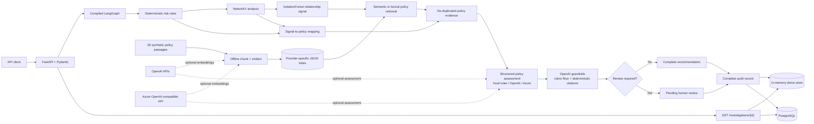

# AI Fraud Investigation Assistant

An AI assistant for UK bank fraud and AML teams that investigates a payment alert, recommends an action with cited policies, and is built so that high-risk and uncertain cases always go to a human reviewer.

**Tech stack:** Python, FastAPI, Pydantic, LangGraph, OpenAI (gpt-4.1-mini, text-embedding-3-small), RAG (vector, BM25, hybrid), scikit-learn, NetworkX, PostgreSQL, Docker, GitHub Actions.

**Scope:** a portfolio project on synthetic data. It recommends actions; it never blocks accounts, rejects payments, or claims a human reviewed a case.

## Key results

All evaluation data is synthetic. On the 60-query retrieval set, moving from the local lexical-hashing vector baseline to OpenAI `text-embedding-3-small` vector search improved hit@1 from **1.67% to 75.00%** and MRR from **0.1705 to 0.8469**.

| Metric | In-sample (50 cases x 3 runs) | Held-out (20 cases x 3 runs) |
|---|---:|---:|
| Missed escalations | 0 | 0 |
| Unnecessary escalations | 0 | 2 |
| System recommendation accuracy | 100% | 90% |
| LLM-alone accuracy | 94% | 85% |
| Routing accuracy | 100% | 90% |
| Citation match | 100% | 100% |
| Latency p50 | ~2.1 s | ~2.1 s |
| Cost per case | ~$0.0009 | ~$0.0009 |

Outcome metrics were identical across all 3 runs.

The rubric was written against the in-sample cases, so the held-out set is the fairer test. In 3 of 50 in-sample cases the LLM recommended a softer action than policy allows and the rubric floor raised it; in 7-8 of 50 it omitted a required citation and deterministic citations added it.

The exact committed outputs are in [`evaluation/decision_results_openai.json`](evaluation/decision_results_openai.json) and [`evaluation/decision_results_openai_holdout.json`](evaluation/decision_results_openai_holdout.json).

### Held-out errors

Both held-out errors were single-signal velocity cases where the model escalated instead of requesting more information. This is stricter than the written policy rather than a missed escalation; whether velocity alone should escalate is a policy decision for the fraud team.

## How it decides

- **Rules enforce policy:** deterministic signals set the minimum permitted recommendation, `HIGH` risk always reaches human review, and required citations are added in code.
- **ML detects patterns:** an IsolationForest supplies a reproducible relationship-anomaly signal alongside explainable NetworkX graph features.
- **The LLM explains:** structured assessment turns the supplied facts and policy evidence into reasons, confidence, missing information, and grounded citations.
- **Humans decide:** the workflow only recommends an action; it never blocks an account, rejects a payment, files a report, or claims that review happened.

## Architecture



Request flow:

```text
FastAPI request -> Pydantic validation -> compiled LangGraph
  -> deterministic risk assessment
  -> NetworkX graph analysis + IsolationForest anomaly signal
  -> semantic retrieval + signal-required policy inclusion
  -> structured policy assessment
  -> rubric floor + deterministic citation enforcement
  -> conditional complete/human-review route
  -> memory or PostgreSQL audit persistence
  -> validated API response and retrievable audit record
```

## What's implemented now

- Strict transaction validation returns HTTP 422; a reused transaction ID with different historical details returns HTTP 409.
- Required API-key authentication protects every investigation endpoint, while `/health` remains public.
- Request IDs are generated or propagated in `X-Request-ID`, with one structured status, timing, and optional LLM-usage log for each HTTP request.
- The full workflow persists a complete or partial audit trail and exposes it through the protected `GET /investigations/{investigation_id}` endpoint.
- OpenAI structured assessment has an application-enforced decision floor, deterministic citations, safe fallbacks, and recorded rejected model identifiers.
- Operational controls provide a hosted-LLM kill switch and deterministic QA sampling of auto-completed cases.
- A network-free suite of 222 unit, workflow, persistence, evaluation, and API tests runs locally and in CI.
- Docker/Compose packaging and GitHub Actions CI are included.

## What problem it demonstrates

Financial-crime investigations often need several kinds of evidence at once: transparent transaction rules, relationship patterns, relevant policy text, and a policy-grounded assessment. This project keeps each concern independent and makes LangGraph responsible for the execution and escalation path. The result demonstrates clear service boundaries, validation, testing, failure handling, evaluation, and auditability without presenting model output as an autonomous decision.

## Project structure

```text
.
├── .github/workflows/
│   ├── ci.yml                           # checks every push and pull request
│   └── publish-image.yml                # tests and publishes the GHCR image
├── app/
│   ├── main.py                         # FastAPI factory and routes
│   ├── config.py                       # environment-backed settings
│   ├── auth.py                         # X-API-Key dependency
│   ├── middleware.py                   # request IDs and HTTP timing logs
│   ├── logging_config.py               # JSON structured logging
│   ├── models/                         # strict Pydantic domain contracts
│   ├── services/
│   │   ├── risk_scorer.py              # deterministic risk rules
│   │   ├── policy_assessment.py        # local + OpenAI + Azure adapters
│   │   └── investigation_service.py    # dependency composition
│   ├── graph/analyzer.py               # explainable NetworkX metrics
│   ├── rag/                             # embeddings, ingestion, retrieval
│   ├── repositories/                    # memory + PostgreSQL persistence
│   ├── workflow/                        # typed state and LangGraph
│   └── evaluation/
│       ├── evaluate.py                  # workflow regression evaluation
│       ├── retrieval_eval.py            # vector/BM25/hybrid comparison
│       └── decision_eval.py             # repeatable live decision evaluation
├── data/
│   ├── policies.json                    # 30 synthetic demo policy passages
│   └── policy_index.json                # generated local vector index
├── evaluation/
│   ├── cases.json                       # small workflow regression cases
│   ├── retrieval_cases.json             # 60 labelled retrieval queries
│   ├── decision_cases.json              # 50 in-sample decision cases
│   └── decision_cases_holdout.json      # 20 held-out decision cases
├── tests/                               # 222 network-free tests
├── docs/azure-deployment-design.md      # prepared Azure design; not deployed
├── scripts/
│   ├── deploy_azure.ps1               # manual Container Apps deployment
│   └── teardown_azure.ps1             # confirmed demo resource cleanup
├── Dockerfile
├── docker-compose.yml
└── requirements.txt
```

## Core behavior

### Deterministic risk assessment

The four additive rules and exact boundaries are:

| Signal | Points | Strict condition |
|---|---:|---|
| Young account | 20 | `account_age_days < 30` |
| New payee | 15 | `new_payee is true` |
| Unusual amount | 30 | `amount > 5 * average_transaction_amount` |
| High velocity | 20 | `transactions_last_24h > 10` |

Scores below 30 are `LOW`, 30–59 are `MEDIUM`, and 60 or above are `HIGH`. Only `HIGH` sets the legacy `investigate` flag. The LLM is never used to calculate or alter this score.

### Graph analysis

`GraphAnalyzer` builds a `networkx.MultiDiGraph` from synthetic account relationships and temporarily adds the request transaction to a copy. It returns:

- unique counterparties and origin degree;
- counterparties shared by both transaction parties;
- repeated direct transaction count;
- direct-counterparty value concentration; and
- named, explainable signals plus a `suspicious` flag.

`GraphAnalyzer` itself uses no ML, external graph database, or real customer data. Optional account IDs preserve compatibility with the original transaction shape; stable role-prefixed demo IDs are derived when they are absent.

### Relationship anomaly scoring

`RelationshipAnomalyScorer` fits an unsupervised scikit-learn `IsolationForest` over the graph metrics using a fixed-seed synthetic training set. It provides a reproducible second opinion on relationship structure; it does not replace or alter the deterministic risk rules and has not been validated against real fraud data.

When deterministic risk is `LOW` or `MEDIUM`, graph analysis is not already `suspicious`, and the model flags the structure as anomalous, the workflow routes the investigation to human review.

### Policy RAG

All 30 bundled policy passages are synthetic internal policies written for this demo. They do not quote or cite real regulations by section and must not be treated as authoritative regulatory text.

Ingestion and query are separate operations:

1. `PolicyIngestor` reads the synthetic policy documents, chunks them with word overlap, obtains embeddings through an `EmbeddingService`, and writes a validated JSON vector index.
2. `PolicyRetriever` loads that stored index at query time and ranks policy chunks with vector similarity, BM25 keyword matching, or hybrid search. Hybrid mode combines both rankings with Reciprocal Rank Fusion and returns deterministic Top-K chunks with `policy_id`, `chunk_id`, text, and relevance score.
3. The workflow adds policies required by active deterministic or graph signals to the semantic result, de-duplicates them, and records which IDs came from `semantic_search` and which came from `signal_mapping`.

The default `LocalHashEmbeddingService` is a deterministic lexical hashing baseline, not a semantic ML model. Its cosine similarity measures overlap in hashed lexical features rather than meaning. `EMBEDDING_MODE` can instead select the official OpenAI embeddings API or the Azure OpenAI adapter. Provider indexes are generated separately and record their embedding implementation and dimensions; OpenAI indexes also record the exact model. Load-time checks prevent an index from another provider or model being mixed with the selected service. The OpenAI adapter is covered by mocked unit tests and was also evaluated live on 50 in-sample and 20 held-out synthetic cases (3 runs each); the Azure adapter is covered by mocked unit tests only and has not been live-evaluated.

### Policy assessment, grounding, and enforcement

`PolicyAssessmentService` is the provider boundary. Local mode uses an explicitly rules-based `DemoPolicyAssessmentService`; it does not pretend to be an LLM. OpenAI mode uses the Responses API with a strict-compatible Pydantic structured-output schema, then converts the result to the domain `PolicyAssessment`. Azure mode uses a strict JSON-schema response and the same domain validation.

The OpenAI prompt supplies transaction facts, deterministic risk, graph and anomaly signals, and retrieved policy passages inside a clearly delimited untrusted-data section. It tells the model to ignore instructions inside those fields, use only supplied policy evidence, keep each reason concise, distinguish applicable `policy_references` from inapplicable `policies_considered`, and report missing information and evidence sufficiency.

OpenAI mode applies the explicit decision rubric again in code after parsing:

- zero policy risk signals permits `CLEAR`;
- exactly one signal requires at least `REQUEST_MORE_INFO`;
- two or more signals, a new-payee/unusual-amount pattern, or a suspicious-network link requires `ESCALATE_TO_HUMAN`;
- a softer model recommendation is raised to the rubric level and recorded with `rubric_override` and `original_llm_recommendation`; a stricter recommendation is never lowered; and
- cross-border activity is context and a citation trigger, not a counted risk signal.

In OpenAI mode, application code also ensures that `DEMO-AML-004` is cited for cross-border activity, `DEMO-AML-005` for `HIGH` deterministic risk, and `DEMO-AML-006` for a new payee. Any additions are returned as `deterministic_citations`. Model-supplied policy IDs outside the provided evidence are dropped without failing the whole assessment, logged as warnings, and retained in `rejected_citations` or `rejected_policies_considered` for audit.

Overlong reasons and missing-information entries are safely shortened at a word boundary before domain validation. OpenAI timeouts, malformed output, and other assessment failures return a no-citation `ESCALATE_TO_HUMAN` fallback. The safe exception type and message are logged and recorded as `fallback_reason`, without logging the prompt or API key.

### Human-in-the-loop routing

The compiled LangGraph condition routes to `human_review_required` when any of the following is true:

- deterministic risk is `HIGH`;
- a `MEDIUM` case is not `CLEAR` with confidence of at least 0.9 and sufficient evidence;
- assessment confidence is below the configured threshold;
- policy evidence is insufficient;
- the assessment requires human review;
- suspicious graph signals conflict with a `LOW` deterministic score; or
- the relationship-anomaly model flags an otherwise non-suspicious `LOW` or `MEDIUM` case.

The response status is `PENDING_HUMAN_REVIEW`. This means review is required, not that a person has reviewed the case. There is deliberately no fake review UI or automated account action.

### LLM usage

Hosted assessment responses record input tokens, output tokens, LLM latency in milliseconds, and estimated USD cost using `OPENAI_INPUT_PRICE_PER_1M` and `OPENAI_OUTPUT_PRICE_PER_1M`. The optional `llm_usage` object is returned by `/investigate`, included in the structured HTTP log, and persisted in the audit trail; it is `null` in local mode. Estimates cover the policy-assessment call only and depend on keeping the configured prices current.

### Persistence and audit trail

Local mode uses a thread-safe, process-local repository and labels the result `backend: memory`. Docker Compose selects the PostgreSQL repository, which creates and upserts an `investigations` table containing indexed summary fields plus the complete JSON audit record.

Each audit record includes:

- the input transaction, risk assessment, graph analysis, and anomaly result;
- retrieved policy IDs, chunk IDs, scores, and semantic-versus-signal retrieval sources;
- the full policy assessment, including recommendation, confidence, reasons, `policy_references`, `policies_considered`, missing information, and evidence sufficiency;
- `original_llm_recommendation`, `rubric_override`, `deterministic_citations`, rejected IDs, and `fallback_reason`;
- the routing decision, first rule fired, and all triggered rules;
- `llm_usage`, per-step timestamps and durations, audit events, errors, and fallbacks; and
- created and updated timestamps plus persistence outcome.

If a workflow step fails before the normal persistence node, the workflow makes a best-effort save of the partial state with the failed step and exception summary. The protected `GET /investigations/{investigation_id}` endpoint returns the stored record, returns HTTP 404 when it does not exist, and returns a fixed HTTP 503 detail if retrieval fails.

Every save returns a validated `PersistenceResult`. A database connection or write failure produces `succeeded: false`, sets the investigation status to `FAILED`, and makes `/investigate` return HTTP 503 with the fixed, non-sensitive error `Investigation could not be saved`. The full database exception is logged with `logger.exception`; it is not returned to the caller, and the service does not silently switch to memory.

## Local setup

Python 3.12 is the tested version.

```powershell
python -m venv .venv
.\.venv\Scripts\Activate.ps1
python -m pip install --upgrade pip
python -m pip install --requirement requirements.txt
Copy-Item .env.example .env
# Set API_KEY in .env to a non-placeholder local value.
python -m app.rag.ingestion
python -m uvicorn app.main:app --reload
```

On macOS/Linux, activate with `source .venv/bin/activate` and copy the environment file with `cp .env.example .env`.

Open `http://127.0.0.1:8000/docs` for the generated OpenAPI UI. Protected endpoints document their HTTP 401 response, and FastAPI's `APIKeyHeader` security scheme supplies the Swagger **Authorize** button.

## Environment variables

| Variable | Default | Purpose |
|---|---|---|
| `APP_ENV` | `development` | Environment label |
| `LOG_LEVEL` | `INFO` | Root JSON log level |
| `API_KEY` | none; required | Key accepted in `X-API-Key` on protected endpoints |
| `SERVICE_MODE` | `local` | `local` rule-based, `openai` OpenAI, or `azure` Azure OpenAI assessment |
| `LLM_ASSESSMENT_ENABLED` | `true` | Set `false` to replace hosted assessment with the rules-based assessor and apply conservative routing |
| `EMBEDDING_MODE` | `local` | `local` lexical baseline, `openai` OpenAI embeddings, or `azure` Azure OpenAI embeddings |
| `PERSISTENCE_BACKEND` | `memory` | `memory` or `postgres` |
| `DATABASE_URL` | unset | Required for PostgreSQL mode |
| `POLICY_INDEX_PATH` | provider-specific | Stored vector index; local uses `data/policy_index.json` and OpenAI uses `data/policy_index_openai.json` unless overridden |
| `RETRIEVAL_MODE` | provider-specific | `vector` with OpenAI embeddings and `hybrid` otherwise; explicit `vector`, `bm25`, or `hybrid` overrides the default |
| `RETRIEVAL_TOP_K` | `3` | Returned semantic policy chunk count before signal-required additions |
| `RETRIEVAL_MIN_RELEVANCE_SCORE` | `0.05` | Minimum cosine score for vector results and hybrid vector candidates |
| `HUMAN_REVIEW_CONFIDENCE_THRESHOLD` | `0.70` | General conditional-route threshold |
| `QA_SAMPLE_RATE` | `0.05` | Deterministic fraction from 0 to 1 of auto-completed cases marked for QA |
| `OPENAI_API_KEY` | unset | Required for OpenAI embeddings, or for OpenAI assessment while the LLM switch is enabled; never committed |
| `OPENAI_CHAT_MODEL` | `gpt-4.1-mini` | OpenAI model used for structured policy assessment |
| `OPENAI_ASSESSMENT_TEMPERATURE` | `0` | OpenAI assessment sampling temperature |
| `OPENAI_EMBEDDING_MODEL` | `text-embedding-3-small` | OpenAI embedding model recorded in the generated index |
| `OPENAI_INPUT_PRICE_PER_1M` | `0.40` | Input-token USD rate used only for cost estimates; check current model pricing |
| `OPENAI_OUTPUT_PRICE_PER_1M` | `1.60` | Output-token USD rate used only for cost estimates; check current model pricing |
| `AZURE_OPENAI_ENDPOINT` | unset | Required for Azure embeddings, or for Azure assessment while the LLM switch is enabled |
| `AZURE_OPENAI_API_KEY` | unset | Required for Azure embeddings, or for Azure assessment while the LLM switch is enabled; never committed |
| `AZURE_OPENAI_CHAT_DEPLOYMENT` | unset | Required when `SERVICE_MODE=azure` and the LLM switch is enabled |
| `AZURE_OPENAI_EMBEDDING_DEPLOYMENT` | unset | Required when `EMBEDDING_MODE=azure` |
| `AZURE_OPENAI_EMBEDDING_DIMENSIONS` | `1536` | Expected Azure embedding vector size |
| `AZURE_OPENAI_API_VERSION` | `2024-10-21` | Azure API version |

`Settings` always requires `API_KEY` and conditionally validates credentials for the selected hosted assessment or embedding mode at startup. No credentials are hard-coded, and `.env` is ignored by Git and Docker. Local embedding and assessment remain the defaults for development, tests, and CI.

## Operational controls

- `LLM_ASSESSMENT_ENABLED=false` prevents construction or use of a hosted chat assessor even when `SERVICE_MODE` is `openai` or `azure`, and uses the deterministic `DemoPolicyAssessmentService` instead. Only `LOW`-risk cases with zero risk signals may complete automatically in this mode; the API records `llm_disabled`, exposes the switch in `/health`, and logs one startup warning.
- `QA_SAMPLE_RATE` marks a deterministic share of cases that completed without human review by hashing `investigation_id`; `0` disables sampling and `1` samples every eligible case. Sampling records `qa_sampled` and the audit routing rule `qa_sample` without changing status or recommendation, and human-review cases are never eligible.

## API examples

Health/liveness requires no API key:

```bash
curl http://127.0.0.1:8000/health
```

Use the value configured as `API_KEY` in the `X-API-Key` header for every other endpoint.

Legacy deterministic endpoint:

```bash
curl -X POST http://127.0.0.1:8000/assess-risk \
  -H "Content-Type: application/json" \
  -H "X-API-Key: replace-with-your-api-key" \
  -d '{"transaction_id":"demo-high-001","amount":6000.0,"account_age_days":10,"new_payee":true,"average_transaction_amount":1000.0,"transactions_last_24h":11,"origin_country":"GB","destination_country":"ES"}'
```

Full investigation:

```bash
curl -X POST http://127.0.0.1:8000/investigate \
  -H "Content-Type: application/json" \
  -H "X-API-Key: replace-with-your-api-key" \
  -d '{"transaction_id":"demo-high-001","amount":6000.0,"account_age_days":10,"new_payee":true,"average_transaction_amount":1000.0,"transactions_last_24h":11,"origin_country":"GB","destination_country":"ES","origin_account_id":"demo-origin","destination_account_id":"demo-destination"}'
```

Retrieve the persisted audit record:

```bash
curl http://127.0.0.1:8000/investigations/replace-with-investigation-id \
  -H "X-API-Key: replace-with-your-api-key"
```

The `/investigate` response contains the deterministic risk result, graph and anomaly results, retrieved passages, the structured policy assessment, optional `llm_usage`, final recommendation and routing status, and persistence outcome. The OpenAPI schema is authoritative.

## Tests and evaluation

Run the complete network-free suite:

```powershell
python -m pytest -q
```

The suite contains 222 tests covering rule boundaries, validation, graph metrics, vector/BM25/hybrid retrieval, mocked OpenAI and Azure embeddings, mocked structured LLM output, rubric enforcement, LangGraph routes, operational controls, complete and partial audit persistence, API-key authentication, request correlation/logging, and evaluation execution. It requires no hosted-provider credentials or paid API calls.

Run the small workflow regression evaluation:

```powershell
python -m app.evaluation.evaluate
```

It calculates deterministic-rule correctness, expected-policy-in-Top-K retrieval, recommendation agreement, exact reference grounding, and escalation behavior. The dataset is synthetic and intended as a regression signal, not evidence of real-world performance.

### Live decision evaluation

For the decision evaluations below, counts and accuracy rates show the mean with the minimum and maximum across three runs in parentheses; latency and cost are rounded headline figures. The runs used OpenAI assessment, OpenAI vector retrieval, `gpt-4.1-mini`, and temperature 0; LLM cost excludes embedding API calls.

`decision_eval` runs labelled cases through the full configured workflow. It reports system and LLM-alone recommendation accuracy, routing accuracy, missed and unnecessary escalations, exact citation match, expected-policy retrieval recall, fallback counts by safe reason, rubric overrides, deterministic citation additions, p50/p95 latency, and total/per-case LLM cost. Each case result records confidence, evidence sufficiency, routing rules, retrieved IDs and sources, citations, considered policies, reasons, rejected IDs, fallback details, and enforcement diagnostics.

With a previously built OpenAI policy index and credentials set in the current PowerShell session, reproduce the committed three-run evaluations with:

```powershell
$env:API_KEY = "replace-with-local-api-key"
$env:SERVICE_MODE = "openai"
$env:EMBEDDING_MODE = "openai"
$env:OPENAI_API_KEY = "replace-with-your-openai-api-key"
$env:POLICY_INDEX_PATH = "data/policy_index_openai.json"
$env:OPENAI_ASSESSMENT_TEMPERATURE = "0"
python -m app.evaluation.decision_eval --cases evaluation/decision_cases.json --runs 3
python -m app.evaluation.decision_eval --cases evaluation/decision_cases_holdout.json --runs 3
```

The output filename includes the service mode and non-default case-set stem, producing `evaluation/decision_results_openai.json` and `evaluation/decision_results_openai_holdout.json` for these commands. They make paid network calls. The reported cost covers policy-assessment tokens only and excludes embedding API cost.

### Retrieval evaluation

The labelled retrieval evaluation contains 60 queries for 30 synthetic policies. The measured results below use the bundled lexical-hashing index and OpenAI `text-embedding-3-small`:

| Embeddings | Retrieval mode | hit@1 | hit@3 | MRR |
|---|---|---:|---:|---:|
| Local hashing | vector | 0.0167 | 0.2167 | 0.1705 |
| Local hashing | BM25 | 0.3000 | 0.5333 | 0.4734 |
| Local hashing | hybrid | 0.1333 | 0.4167 | 0.3247 |
| OpenAI `text-embedding-3-small` | vector | 0.7500 | 0.9667 | 0.8469 |
| OpenAI `text-embedding-3-small` | BM25 | 0.3000 | 0.5333 | 0.4734 |
| OpenAI `text-embedding-3-small` | hybrid | 0.5833 | 0.8333 | 0.7227 |

Rebuild the local index and evaluate vector, BM25, and hybrid retrieval:

```powershell
$env:EMBEDDING_MODE = "local"
python -m app.rag.ingestion --source data/policies.json --output data/policy_index.json
python -m app.evaluation.retrieval_eval --index data/policy_index.json
```

Build and evaluate the separate OpenAI index with the same cases:

```powershell
$env:EMBEDDING_MODE = "openai"
$env:OPENAI_API_KEY = "replace-with-your-openai-api-key"
$env:OPENAI_EMBEDDING_MODEL = "text-embedding-3-small"
python -m app.rag.ingestion --source data/policies.json --output data/policy_index_openai.json
python -m app.evaluation.retrieval_eval --index data/policy_index_openai.json
```

The OpenAI commands make paid network calls. Keep the local and OpenAI index files separate; recorded provider and model metadata prevents accidental mixing.

OpenAI embeddings fixed the lexical baseline's weak paraphrase matching. Hybrid retrieval underperformed vector retrieval because the evaluation deliberately uses paraphrased queries with little wording overlap, so BM25's lexical ranking diluted the stronger vector ranking during fusion. For that reason, `vector` is the default when `EMBEDDING_MODE=openai`; explicitly setting `RETRIEVAL_MODE` still overrides it.

MRR, or mean reciprocal rank, rewards placing the first correct policy near the top: a first-place answer scores 1, second place scores 1/2, third place scores 1/3, and a miss scores 0 before averaging across queries.

## Docker and PostgreSQL

Create `.env`, replace the placeholder password and API key, then start the API and PostgreSQL:

```powershell
Copy-Item .env.example .env
# Set POSTGRES_PASSWORD in .env to a local, non-placeholder value.
# Set API_KEY in .env to a local, non-placeholder value.
docker compose config
docker compose up --build
```

Compose waits for the PostgreSQL health check and configures the API to use the PostgreSQL repository. Stop it with `docker compose down`; add `--volumes` only if you intentionally want to remove the local database volume.

## Deploying to Azure

On pushes to `main` and manual dispatches,
`.github/workflows/publish-image.yml` runs pytest and then builds the Dockerfile.
It publishes `ghcr.io/joffie89/agentic-fincrime-investigation` with both `latest`
and commit-SHA tags. The Docker build context excludes `.env` and `.env.*`.

After the first successful publication, open the package settings on GitHub and
change the GHCR package visibility to **Public** once. Azure Container Apps can
then pull it without registry credentials. After installing the Azure CLI,
selecting the intended subscription, and running `az login`, execute:

```powershell
.\scripts\deploy_azure.ps1
```

The script securely prompts for `API_KEY` and `OPENAI_API_KEY`, pulls the
prebuilt `latest` image, stores both values as Container Apps secrets, deploys
the bundled OpenAI policy index behind external ingress, and prints the app URL.
It uses resource group `fincrime-demo-rg` in `uksouth`, with zero to one replica.
To deploy an immutable build, pass its commit-SHA tag explicitly:

```powershell
.\scripts\deploy_azure.ps1 -Image ghcr.io/joffie89/agentic-fincrime-investigation:<commit-sha>
```

This demo sets `PERSISTENCE_BACKEND=memory`. Investigation and audit records are
lost whenever its replica stops or restarts, including when Container Apps
scales to zero. Delete the complete demo resource group with the separately
confirmed teardown script:

```powershell
.\scripts\teardown_azure.ps1
```

See [`docs/azure-deployment-design.md`](docs/azure-deployment-design.md) for the
demo configuration, limitations, and a separate production-oriented topology.

## CI/CD

`.github/workflows/ci.yml` defines CI for pushes and pull requests. It installs dependencies, checks the environment, compiles the application, runs pytest, validates Compose, and builds the Docker image. It does not deploy anywhere.

`.github/workflows/publish-image.yml` runs pytest and publishes `latest` and
commit-SHA image tags to GHCR. It never deploys to Azure. The Azure scripts are
manual and opt-in; neither workflow invokes them.

## Responsible AI

- Risk scoring stays deterministic, separately testable, and explainable.
- Retrieved evidence, policy sources, applicable references, and considered policies are returned for inspection.
- OpenAI model output is schema-validated; softer-than-policy recommendations are raised, and unsupported policy IDs are dropped, logged, and recorded.
- High risk, uncertainty, missing evidence, provider failure, or conflicting signals fail toward human review.
- No node blocks an account, rejects a payment, files a report, or asserts guilt.
- Logs avoid transaction amounts, full prompts, and credentials by default.
- All bundled transactions, relationships, policies, and evaluation cases are synthetic and written for this demo.

## Implemented versus designed

| Area | Implemented here | Designed/future only |
|---|---|---|
| API | FastAPI health, legacy risk, full investigation, and audit-retrieval endpoints; validation responses; API-key authentication | Role-based authorization, quotas |
| Orchestration | Compiled typed LangGraph with conditional routing, rule-floor enforcement, and partial-failure persistence | Distributed workers, durable graph checkpoints |
| Risk | Four deterministic score rules plus an explicit recommendation rubric and boundary tests | Institution-approved controls and model governance |
| Graph | In-process NetworkX over synthetic relationships | Live graph store, entity resolution, temporal analytics |
| ML anomaly signal | IsolationForest over graph features, fixed-seed synthetic training set, routes disagreements to human review | Training on real historical data, retraining, drift monitoring |
| RAG | Synthetic corpus, local lexical-hash/OpenAI/Azure embeddings, BM25, RRF hybrid search, signal-based inclusion, provider-specific indexes, Top-K | Managed vector database, policy lifecycle and approval workflow |
| AI | Rule-based local assessor; OpenAI and Azure structured adapters; safe fallbacks; hosted-assessment kill switch with conservative routing; OpenAI live evaluation on synthetic cases; mocked provider tests | Evaluation on real institution-labelled cases, production monitoring, prompt/version registry |
| Human review | Explicit pending status and fail-safe routing | Reviewer UI, assignment, approval and override audit events |
| Persistence | Memory and PostgreSQL repositories; complete/partial JSON audit records; protected retrieval endpoint | Versioned migrations, pooling, retention, encryption policy, HA |
| Operations | JSON logs with request IDs, timing and LLM usage; deterministic QA sampling for auto-completed cases; Docker/Compose; GitHub Actions CI | Actual Azure resources/deployment, observability backend |

## Limitations

- The rules, graph thresholds, policy text, and evaluation expectations are demo choices, not regulator- or institution-approved controls.
- The decision labels were written by the project author using an explicit rubric, not by fraud analysts; the OpenAI path was evaluated live only on synthetic in-sample and held-out cases.
- The held-out set has 20 cases, and its two errors expose an unresolved policy choice about velocity-only alerts rather than proving production accuracy.
- The local hash embedding is lexical and much weaker than a production semantic retrieval model.
- The NetworkX graph is static, small, in-process, and has no entity resolution.
- Local memory persistence is lost when the process exits.
- PostgreSQL schema creation is convenient for the demo; production would use versioned migrations and a connection pool.
- Azure adapters are mock-tested but have not been live-evaluated here; hosted modes require the user's credentials and compatible deployments.
- Reported LLM cost uses configurable example prices, excludes embedding calls, and will drift unless those settings are kept current.
- No role-based authorization, PII controls, sanctions data, case-management UI, human-review completion endpoint, or actual cloud deployment is included.
