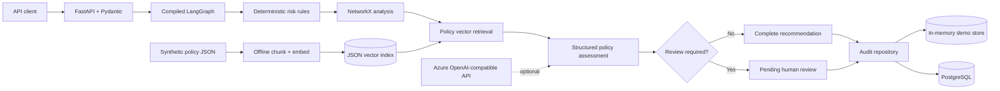

# Agentic Financial Crime Investigation Platform

An interview-sized, enterprise-style Python prototype showing how deterministic
risk rules, explainable relationship analysis, policy retrieval, structured model
reasoning, human-review controls, and audit persistence can fit into one coherent
financial-crime investigation workflow.

This is a portfolio demonstration—not a production AML decision system. It uses
only synthetic data, produces recommendations rather than consequential actions,
and never claims that a human reviewed a case when they did not.

## What problem it demonstrates

Financial-crime investigations often need several kinds of evidence at once:
transparent transaction rules, relationship patterns, relevant policy text, and a
reasoned recommendation. This project keeps each concern independent and makes
LangGraph responsible for the actual execution and escalation path. The result is
small enough to explain component by component while still demonstrating service
boundaries, validation, testing, failure handling, and auditability.

## Architecture



Request flow:

```text
FastAPI request -> Pydantic validation -> compiled LangGraph
  -> deterministic risk assessment
  -> NetworkX graph analysis
  -> Top-K policy retrieval
  -> validated policy assessment
  -> conditional complete/human-review route
  -> memory or PostgreSQL audit persistence
  -> validated API response
```

## Project structure

```text
.
├── app/
│   ├── main.py                         # FastAPI factory and routes
│   ├── config.py                       # environment-backed settings
│   ├── logging_config.py               # JSON structured logging
│   ├── models/                         # strict Pydantic domain contracts
│   ├── services/
│   │   ├── risk_scorer.py              # preserved deterministic rules
│   │   ├── policy_assessment.py        # local + Azure adapters
│   │   └── investigation_service.py    # dependency composition
│   ├── graph/analyzer.py               # explainable NetworkX metrics
│   ├── rag/                             # embeddings, ingestion, retrieval
│   ├── repositories/                    # memory + PostgreSQL persistence
│   ├── workflow/                        # typed state and LangGraph
│   └── evaluation/evaluate.py           # executable evaluation harness
├── data/
│   ├── policies.json                    # original synthetic policy text
│   └── policy_index.json                # generated local vector index
├── evaluation/cases.json                # synthetic expected outcomes
├── tests/                               # unit and API/workflow tests
├── docs/azure-deployment-design.md      # design only; not deployed
├── Dockerfile
├── docker-compose.yml
└── requirements.txt
```

## Core behavior

### Deterministic risk assessment

The original four additive rules and exact boundaries are preserved:

| Signal | Points | Strict condition |
|---|---:|---|
| Young account | 20 | `account_age_days < 30` |
| New payee | 15 | `new_payee is true` |
| Unusual amount | 30 | `amount > 5 * average_transaction_amount` |
| High velocity | 20 | `transactions_last_24h > 10` |

Scores below 30 are `LOW`, 30–59 are `MEDIUM`, and 60 or above are
`HIGH`. Only `HIGH` sets the legacy `investigate` flag. The LLM is never used to
calculate or alter this score.

### Graph analysis

`GraphAnalyzer` builds a `networkx.MultiDiGraph` from synthetic account
relationships and temporarily adds the request transaction to a copy. It returns:

- unique counterparties and origin degree;
- counterparties shared by both transaction parties;
- repeated direct transaction count;
- direct-counterparty value concentration; and
- named, explainable signals plus a `suspicious` flag.

No graph ML, external graph database, or real customer data is used. Optional
account IDs preserve compatibility with the original transaction shape; stable
role-prefixed demo IDs are derived when they are absent.

### Relationship anomaly scoring

`RelationshipAnomalyScorer` fits an unsupervised scikit-learn `IsolationForest`
over the graph metrics using a fixed-seed synthetic training set. It provides a
reproducible second opinion on relationship structure; it does not replace or
alter the deterministic risk rules and has not been validated against real fraud
data.

When deterministic risk is `LOW` or `MEDIUM`, graph analysis is not already
`suspicious`, and the model flags the structure as anomalous, the workflow routes
the investigation to human review.

### Policy RAG

Ingestion and query are separate operations:

1. `PolicyIngestor` reads the synthetic policy documents, chunks them with word
   overlap, obtains embeddings through an `EmbeddingService`, and writes a
   validated JSON vector index.
2. `PolicyRetriever` loads that stored index at query time, embeds the investigation
   query, calculates cosine similarity, and returns deterministic Top-K chunks with
   `policy_id`, `chunk_id`, text, and relevance score.

The default `LocalHashEmbeddingService` is a deterministic lexical hashing
baseline, not a semantic ML model. It keeps the complete demo offline and
repeatable. An injected `AzureOpenAIEmbeddingService` adapter is implemented and
mock-tested for separately generated Azure-compatible indexes; the bundled index
and default application composition remain local.

Rebuild the bundled index explicitly:

```powershell
python -m app.rag.ingestion --source data/policies.json --output data/policy_index.json
```

### Policy assessment and grounding

`PolicyAssessmentService` is the provider boundary. Local mode uses an explicitly
rules-based `DemoPolicyAssessmentService`; it does not pretend to be an LLM.
Azure mode creates an Azure OpenAI client from environment settings and requests a
strict JSON-schema response that is validated again as `PolicyAssessment`.

The hosted prompt instructs the model to:

- use only supplied policy evidence for policy claims;
- report insufficient evidence;
- never fabricate policy identifiers;
- avoid autonomous consequential actions; and
- return structured output.

The adapter rejects references that were not among the retrieved chunks. Provider
or validation failures become a low-confidence, insufficient-evidence result that
requires human review; they are logged and are not silently swallowed.

### Human-in-the-loop routing

The compiled LangGraph condition routes to `human_review_required` when any of the
following is true:

- deterministic risk is `HIGH`;
- assessment confidence is below the configured threshold;
- policy evidence is insufficient;
- the assessment itself requests human review; or
- suspicious graph signals conflict with a `LOW` deterministic score.

The response status is `PENDING_HUMAN_REVIEW`. This means review is required—not
that a person has reviewed the case. There is deliberately no fake review UI or
automated account action.

### Persistence and failure semantics

Local mode uses a thread-safe, process-local repository and labels the result
`backend: memory`. Docker Compose selects the PostgreSQL repository, which creates
and upserts an `investigations` table containing the useful summary fields plus a
complete JSON audit record.

Every save returns a validated `PersistenceResult`. A database connection/write
failure produces `succeeded: false`, sets the investigation status to `FAILED`, and
makes `/investigate` return HTTP 503 with that truthful response body. The service
does not silently switch from PostgreSQL to memory.

## Local setup

Python 3.12 is the tested version.

```powershell
python -m venv .venv
.\.venv\Scripts\Activate.ps1
python -m pip install --upgrade pip
python -m pip install --requirement requirements.txt
Copy-Item .env.example .env
python -m app.rag.ingestion
python -m uvicorn app.main:app --reload
```

On macOS/Linux, activate with `source .venv/bin/activate` and copy the environment
file with `cp .env.example .env`.

Open `http://127.0.0.1:8000/docs` for the generated OpenAPI UI.

## Environment variables

| Variable | Default | Purpose |
|---|---|---|
| `APP_ENV` | `development` | Environment label |
| `LOG_LEVEL` | `INFO` | Root JSON log level |
| `SERVICE_MODE` | `local` | `local` deterministic assessor or `azure` LLM adapter |
| `PERSISTENCE_BACKEND` | `memory` | `memory` or `postgres` |
| `DATABASE_URL` | unset | Required for PostgreSQL mode |
| `POLICY_INDEX_PATH` | `data/policy_index.json` | Stored vector index |
| `RETRIEVAL_TOP_K` | `3` | Returned policy chunk count |
| `HUMAN_REVIEW_CONFIDENCE_THRESHOLD` | `0.70` | Conditional-route threshold |
| `AZURE_OPENAI_ENDPOINT` | unset | Required in Azure mode |
| `AZURE_OPENAI_API_KEY` | unset | Required in Azure mode; never committed |
| `AZURE_OPENAI_CHAT_DEPLOYMENT` | unset | Azure chat deployment name |
| `AZURE_OPENAI_EMBEDDING_DEPLOYMENT` | unset | Reserved for the Azure embedding adapter |
| `AZURE_OPENAI_API_VERSION` | `2024-10-21` | Azure API version |

`Settings` validates selected backends at startup. No credentials are hard-coded,
and `.env` is ignored by Git and Docker.

## API examples

Health/liveness:

```bash
curl http://127.0.0.1:8000/health
```

Legacy deterministic endpoint:

```bash
curl -X POST http://127.0.0.1:8000/assess-risk \
  -H "Content-Type: application/json" \
  -d '{"transaction_id":"demo-high-001","amount":6000.0,"account_age_days":10,"new_payee":true,"average_transaction_amount":1000.0,"transactions_last_24h":11,"origin_country":"GB","destination_country":"ES"}'
```

Full investigation:

```bash
curl -X POST http://127.0.0.1:8000/investigate \
  -H "Content-Type: application/json" \
  -d '{"transaction_id":"demo-high-001","amount":6000.0,"account_age_days":10,"new_payee":true,"average_transaction_amount":1000.0,"transactions_last_24h":11,"origin_country":"GB","destination_country":"ES","origin_account_id":"demo-origin","destination_account_id":"demo-destination"}'
```

Abridged local-mode response (IDs/timestamps vary):

```json
{
  "investigation_id": "10258beb-5603-44fa-b234-ba3c5f2d817b",
  "transaction_id": "demo-high-001",
  "risk_assessment": {
    "risk_score": 85,
    "risk_level": "HIGH",
    "risk_reasons": [
      "Account is less than 30 days old",
      "Transaction is to a new payee",
      "Transaction amount is more than 5 times the average",
      "More than 10 transactions in the last 24 hours"
    ],
    "investigate": true
  },
  "retrieved_policies": [
    {"policy_id": "DEMO-AML-001", "chunk_id": "DEMO-AML-001#001", "text": "...", "relevance_score": 0.419903}
  ],
  "recommendation": "ESCALATE_TO_HUMAN",
  "reasons": ["Deterministic risk is HIGH; a person must review the evidence before any action."],
  "requires_human_review": true,
  "status": "PENDING_HUMAN_REVIEW",
  "persistence": {"succeeded": true, "backend": "memory", "error": null},
  "created_at": "2026-09-06T06:12:51.136288Z"
}
```

The real response also contains the full graph result and structured policy
assessment; the OpenAPI schema is authoritative.

## Tests and evaluation

Run the complete network-free suite:

```powershell
python -m pytest -q
```

Tests cover rule boundaries, model validation, graph metrics, policy ingestion and
Top-K retrieval, mocked Azure embedding/LLM output, LangGraph routes, escalation,
persistence success/failure, API behavior, and evaluation execution. They require
neither Azure credentials nor paid API calls.

Run the evaluation:

```powershell
python -m app.evaluation.evaluate
```

The script calculates and prints observed counts and accuracies for deterministic
rule correctness, expected-policy-in-Top-K retrieval, recommendation agreement,
reference grounding, and escalation behavior. The dataset is intentionally small;
results are a regression signal for this demo, not evidence of real-world model
performance.

## Docker and PostgreSQL

Create `.env`, replace the demo password, then start the API and PostgreSQL:

```powershell
Copy-Item .env.example .env
# Set POSTGRES_PASSWORD in .env to a local, non-placeholder value.
docker compose config
docker compose up --build
```

Compose waits for the PostgreSQL health check and configures the API to use the
PostgreSQL repository. Stop it with `docker compose down`; add `--volumes` only if
you intentionally want to remove the local database volume.

## CI/CD

`.github/workflows/ci.yml` defines CI for pushes and pull requests. It installs
dependencies, checks the environment, compiles the application, runs pytest,
validates Compose, and builds the Docker image. It does not deploy anywhere.

An intended Azure topology is documented separately in
[`docs/azure-deployment-design.md`](docs/azure-deployment-design.md). That document
is a design, not evidence of a completed deployment.

## Responsible AI

- Risk scoring stays deterministic, separately testable, and explainable.
- Retrieved evidence and policy identifiers are returned for inspection.
- Model output is schema-validated and cannot silently add policy references.
- High risk, uncertainty, missing evidence, or conflicting signals fail toward
  human review.
- No node blocks an account, rejects a payment, files a report, or asserts guilt.
- Logs avoid transaction amounts and full model prompts by default.
- All bundled transactions, relationships, policies, and evaluation cases are
  synthetic and written for this demo.

## Implemented versus designed

| Area | Implemented here | Designed/future only |
|---|---|---|
| API | FastAPI health, legacy risk, and full investigation endpoints | Authentication, authorization, quotas |
| Orchestration | Compiled typed LangGraph with a real conditional branch | Distributed workers, durable graph checkpoints |
| Risk | Four preserved deterministic rules and boundary tests | Calibrated production rules/model governance |
| Graph | In-process NetworkX over synthetic relationships | Live graph store, entity resolution, temporal analytics |
| ML anomaly signal | IsolationForest over graph features, fixed-seed synthetic training set, routes to human review on disagreement | Trained on real historical data, periodic retraining, drift monitoring |
| RAG | Synthetic corpus, chunking, local vectors, JSON index, Top-K | Managed vector database, policy lifecycle/approval workflow |
| AI | Deterministic local assessor; Azure chat and embedding adapters; mocked tests | Live Azure validation, monitoring, prompt/version registry |
| Human review | Explicit pending status and fail-safe routing | Reviewer UI, assignment, approval/override audit events |
| Persistence | Memory demo repository and PostgreSQL implementation | Migrations, pooling, retention, encryption policy, HA |
| Operations | JSON logs, Docker/Compose, GitHub Actions CI | Actual Azure resources/deployment, observability backend |

## Limitations

- The rules, graph thresholds, policy text, and evaluation expectations are demo
  choices, not regulator- or institution-approved controls.
- The local hash embedding is lexical and much weaker than a production semantic
  retrieval model.
- The NetworkX graph is static, small, in-process, and has no entity resolution.
- Local memory persistence is lost when the process exits.
- PostgreSQL schema creation is convenient for the prototype; production would use
  versioned migrations and a connection pool.
- Azure adapters are mock-tested but require the user's compatible Azure
  deployments and were not called by the test suite.
- No authentication, authorization, PII controls, sanctions data, case-management
  UI, human-review completion endpoint, or actual cloud deployment is included.
